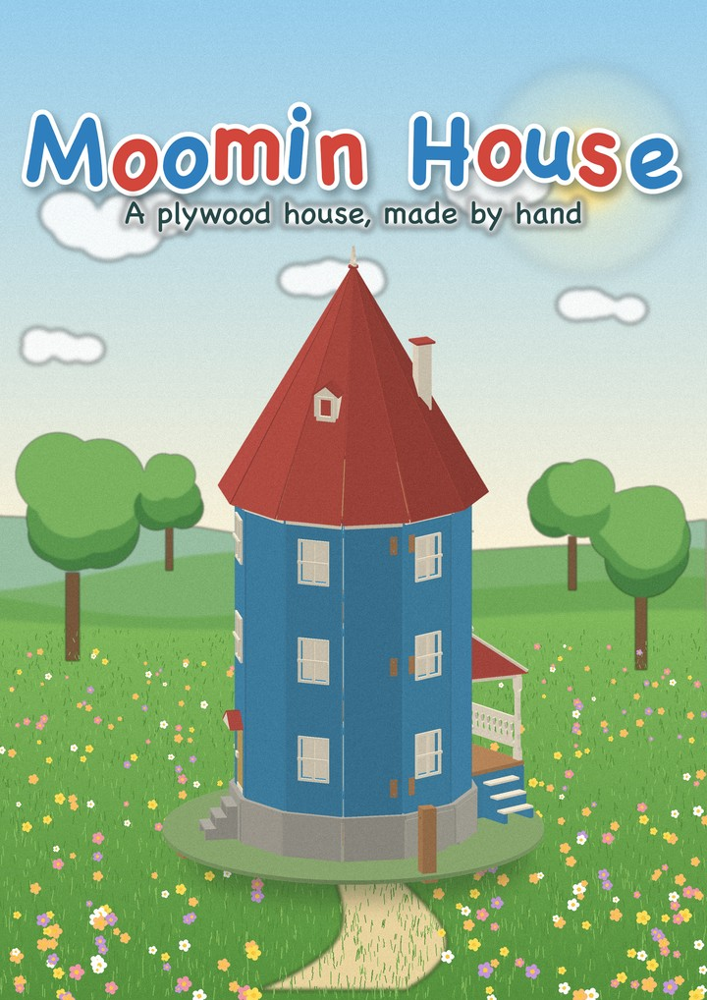
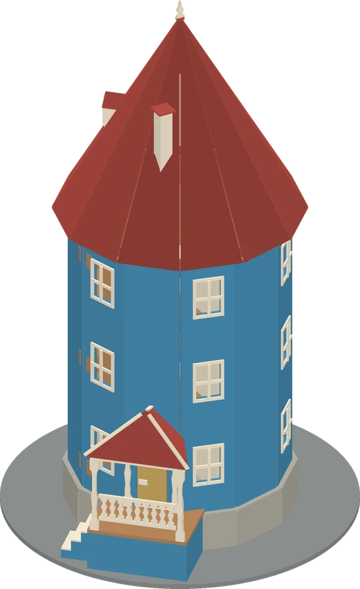
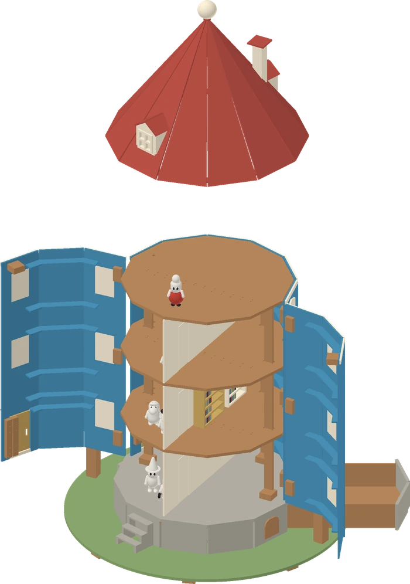
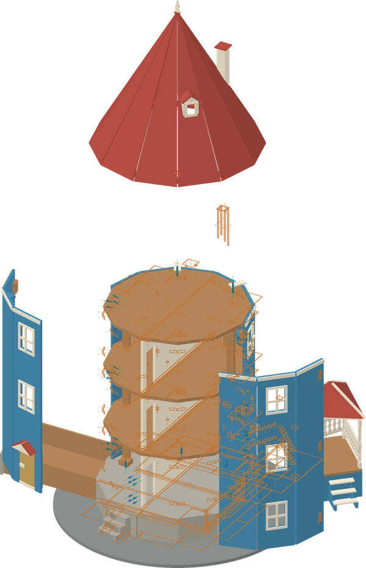
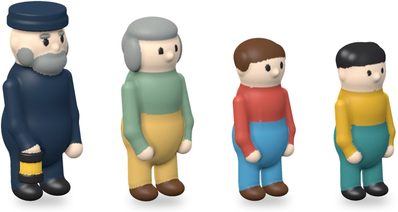
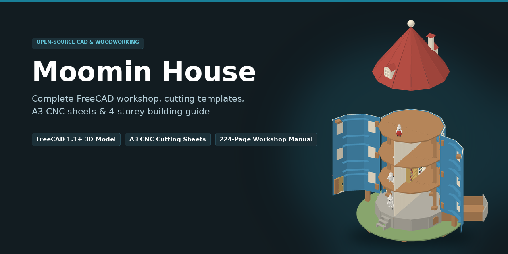

# Domek Muminków

[English](README.md) · **Polski**

**Domek dla lalek ze sklejki, w całości generowany z kodu.** Jeden model w Pythonie i jeden plik konfiguracji tworzą dokument FreeCAD, rozkroje arkuszy, książkę budowy na A4 z szablonami 1:1, rendery i interaktywną przeglądarkę 3D. Automatyczne kontrole sprawdzają, czy ściany, drzwi, szuflada i dach poruszają się bez kolizji.

<p align="center">
  
</p>

Domek to niebieska wieża z czerwonym spiczastym dachem, trzema kondygnacjami i poddaszem. Wszystkie części ze sklejki mieszczą się na A3 (297 × 420 mm). Można je obrabiać CNC lub wycinać ręcznie z szablonów A4. Przednie ściany otwierają się na zawiasach. Dach z dwiema lukarnami jest zdejmowany, weranda z drabinką sznurową stoi na stałe z boku, tylne drzwi prowadzą do drewutni, a kamienny cokół kryje szufladę. W domku mieszka sześć figurek z modeliny termoutwardzalnej: rodzina Muminków, Włóczykij, Panna Migotka i Mała Mi.

<p align="center">
  <b><a href="https://hvitis.github.io/MoominsHouse/">Otwórz model 3D w przeglądarce</a></b> &nbsp;·&nbsp;
  <b><a href="https://github.com/hvitis/moominshouse/releases/latest">Pobierz książkę budowy (PDF)</a></b>
</p>

> To nieoficjalny, niekomercyjny projekt fanowski. Nie jest powiązany z Moomin Characters Oy ani producentami komercyjnych zestawów domku Muminków. Żaden z tych podmiotów go nie zatwierdził. Zobacz [znaki towarowe i licencję](#znaki-towarowe-i-licencja).

<table>
  <tr>
    <td align="center"><br><sub>Zamknięty, od strony werandy</sub></td>
    <td align="center"><br><sub>Otwarte ściany, podniesiony dach</sub></td>
    <td align="center"><br><sub>Widok rozstrzelony</sub></td>
  </tr>
</table>

<p align="center">
  <br>
  <sub>Rodzina z modeliny: model z brył, objętości i gramatura każdego koloru</sub>
</p>

<!-- specifications:start -->
| Parametr | Wartość |
| --- | --- |
| Wysokość całkowita | 778.4 mm |
| Średnica podstawy / sklejka | 522.7 mm / 6 mm |
| Wysokość cokołu | 61.6 mm |
| Średnica wieży / sklejka ścian | 326.7 mm / 3 mm |
| Wysokość ścian stałych / otwieranych | 420 mm / 418 mm |
| Sklejka podłóg / poziomy podłóg | 6 mm / Z73.6, Z213.6, Z353.6, Z493.6 |
| Wysokość pomieszczeń | 134 mm |
| Słupki: liczba / przekrój / długość | 4 / 6 × 16.8 mm / 402 mm |
| Luz otworów słupków | 0.6 mm |
| Średnica dachu / wysokość okapu | 373.3 mm / Z493.6 |
| Pierścień dachu: segmenty / sklejka | 3 / 3 mm |
| Segmenty podstawy | 8 |
| Podest werandy / ściana | 149.3 × 84 mm / W07 |
| Wysuw szuflady | 200 mm |
| Kąt otwarcia ścian | 100° |
| Listwy pod podłogami: parter / piętra | 3 × 4 mm / 3 × 12 mm |
| Luz połączeń podłóg | 0.1 mm |
<!-- specifications:end -->

## Możliwości

- **Dokumentacja do wykonania domku.** Każda część ma grubość sklejki, obrys, otwory i otwory startowe dla wyrzynarki. Rozkrój uwzględnia rzeczywiste wymiary arkuszy. Książka zawiera szablony 1:1 podzielone na strony, kwadrat kalibracyjny, szablony kontroli zawiasów, listę okuć i instrukcję montażu.
- **Ruchome elementy.** Dwie przednie części ściany otwierają się do 100°. Magnesy zamknięte w drewnie słupków ogrodowych utrzymują je w tej pozycji, a zaczepy pod podłogą poddasza utrzymują ściany zamknięte. Troje drzwi wejściowych otwiera się na zewnątrz, a pokoje na każdej kondygnacji łączą drzwi na zawiasach z taśmy bawełnianej. Dach można zdjąć z wieży. Szuflada wysuwa się z cokołu na 200 mm i nie da się jej wyciągnąć. Opcjonalne oświetlenie LED ma otwory na przewód i zakręcany schowek na baterie.
- **Jedna konfiguracja steruje całością.** Wysokość, podstawa, cokół, szuflada, drzwi, położenie i wymiary werandy, otwory zawiasów, arkusze sklejki i kolory znajdują się w `source/config.json`.
- **Automatyczne kontrole.** Każda kompilacja sprawdza przenikanie brył, ruch ścian co 5° aż do ogranicznika 100° i ruch wszystkich sześciorga drzwi. Sprawdza też szufladę aż do ogranicznika, podnoszenie dachu, prześwity okien, przejście każdej figurki przez każde drzwi i to, że żadnej nie da się połknąć, zamknięcie każdego magnesu w drewnie, przypisanie każdej części do jednego kroku montażu, odstępy rozkroju, liczbę części i okuć oraz skalę PDF. Osobne kontrole odtwarzają domek dla najcieńszej i najgrubszej zmierzonej sklejki, liczą łańcuchy tolerancji każdego połączenia i siłę przewrócenia przy otwartych ścianach. Niepowodzenie dowolnej kontroli zatrzymuje kompilację.
- **Figurki z modeliny.** Tatuś Muminka, Mamusia Muminka, Muminek, Włóczykij, Panna Migotka i Mała Mi powstają z łączonych brył opisanych polem odległości. Model oblicza objętość figurki, gramaturę każdego koloru i oszczędność przy zastosowaniu rdzenia z folii aluminiowej.
- **Wiele formatów wyjściowych.** Edytowalny dokument FreeCAD, bryły STEP (domek zamknięty, otwarty, rozstrzelony i każda część osobno), profile DXF, rozkroje SVG, pliki operacji CNC SVG i DXF, dokumenty PDF oraz listy zakupów CSV.

## Wypróbuj przeglądarkę 3D — bez FreeCAD

Najłatwiej otworzyć [przeglądarkę online](https://hvitis.github.io/MoominsHouse/). GitHub przebudowuje ją po każdym wysłaniu zmian na gałąź `main`. Do uruchomienia lokalnego lub podglądu własnej konfiguracji potrzebujesz Pythona 3.12 lub nowszego oraz Git.

```sh
git clone https://github.com/hvitis/moominshouse.git
cd moominshouse
python3 -m venv .venv
.venv/bin/python -m pip install -r requirements.txt
.venv/bin/python source/serve.py --open
```

W Windows użyj `py -3.12 -m venv .venv`. Zastąp `.venv/bin/python` poleceniem `.venv\Scripts\python`.

Przy pierwszym uruchomieniu `serve.py` tworzy `output/parts.json` na podstawie modelu. Trwa to około 10 sekund. Przygotowuje też DXF wykonawcy. Zgodna kompilacja produkcyjna udostępnia gotowy rozkrój. Bez niej obliczenie rozkroju może potrwać kilka minut. Następnie otwiera <http://127.0.0.1:8765/> lub kolejny wolny port. Przeglądarka działa bez internetu, ponieważ repozytorium zawiera three.js. Serwer domyślnie przyjmuje połączenia tylko z Twojego komputera.

Meble występują wyłącznie w przeglądarce 3D i na renderach. Zestaw budowlany nie zawiera ich planów CAD, rozkrojów ani wydruków.

W przeglądarce możesz:

- otwierać ściany wokół rzeczywistych osi zawiasów, otwierać drzwi, podnosić lub zdejmować dach i wysuwać szufladę;
- pokazywać lub ukrywać werandę, meble, figurki, śruby, osie zawiasów i wymiary;
- włączać przezroczystość ścian, rozsuwać zespoły i odcinać model powyżej wybranej wysokości;
- kliknąć część, aby zobaczyć jej identyfikator, wymiary, liczbę i uwagę montażową, lub figurkę, aby zobaczyć zapotrzebowanie na modelinę;
- włączyć **Piece IDs**, aby wyświetlić oznaczenia części na modelu;
- wyszukać pełny identyfikator części lub egzemplarza, aby włączyć podgląd rentgenowski, zaznaczyć pasujące elementy na żółto i wyśrodkować kamerę;
- otworzyć **Settings → DXF**, aby przesuwać i powiększać rysunek wykonawcy, przełączać warstwy grubości oraz oznaczenia **Piece IDs**. Możesz otworzyć inny DXF lub pobrać wyświetlany plik.

Po zmianie `source/config.json` uruchom `serve.py --rebuild`, aby odświeżyć model.

## Meble do druku 3D

[Strona wydruków](https://hvitis.github.io/MoominsHouse/#printables) pokazuje meble do domku, które można wydrukować w 3D. Każdy mebel możesz obracać w 3D i sprawdzić wyniki kontroli druku: czy mieści się na drukarce, czy nie wymaga podpór, czy ścianki są dość grube i czy jest za duży do połknięcia. Możesz też pobrać pliki STL, 3MF lub STEP. Każdy mebel to krótki plik Pythona w `source/prints/`. Na Macu `make studio` otwiera podgląd na żywo, który przebudowuje część po każdym zapisie pliku i każdym ruchu suwaka wymiaru. `make prints` publikuje pliki na stronę. To zakładka **3D printables** przeglądarki online; CI publikuje ją razem z przeglądarką po każdym wysłaniu zmian na `main`. Szczegóły (po angielsku): [docs/PRINTING.md](docs/PRINTING.md).

## Wygeneruj pliki do budowy

Pliki PDF, CAD i rozkroje **nie znajdują się w repozytorium**. Zajmują łącznie około 100 MB i powstają z kodu źródłowego.

**Jeśli chcesz tylko zbudować domek,** pobierz dokumenty PDF i zestaw z [najnowszego wydania](https://github.com/hvitis/moominshouse/releases/latest). Samodzielnie generuj pliki, gdy zmieniasz projekt.

**1. Zainstaluj FreeCAD 1.1 lub nowszy.** Etapy CAD używają Pythona dostarczanego z FreeCAD. Udostępnia on jądro OpenCASCADE, numpy i shapely.

| System | Instalacja | `--freecad-python` |
| --- | --- | --- |
| macOS (sprawdzony) | `brew install --cask freecad` | `/Applications/FreeCAD.app/Contents/Resources/bin/python` |
| Linux (niesprawdzony) | Pobierz AppImage z [freecad.org](https://www.freecad.org/downloads.php), następnie uruchom `./FreeCAD_*.AppImage --appimage-extract` | `squashfs-root/usr/bin/python` |
| Windows (niesprawdzony) | Użyj instalatora z [freecad.org](https://www.freecad.org/downloads.php) | na przykład `"C:\Program Files\FreeCAD 1.1\bin\python.exe"` |

Przed pełną kompilacją sprawdź, czy ten interpreter wczytuje potrzebne moduły:

```sh
FREECAD_PYTHON=/Applications/FreeCAD.app/Contents/Resources/bin/python
"$FREECAD_PYTHON" -c "import sys,pathlib; sys.path.insert(0,str(pathlib.Path(sys.executable).resolve().parent.parent/'lib')); import FreeCAD, Part, Sketcher, numpy, shapely; print('FreeCAD', '.'.join(FreeCAD.Version()[:3]), 'OK')"
```

**2. Przygotuj zwykłe środowisko Pythona**, tak samo jak dla przeglądarki 3D.

**3. Wygeneruj całość:**

```sh
make all        # kontrola konfiguracji, testy, pełna kompilacja i kontrola grubości sklejki
```

`make` domyślnie używa ścieżki FreeCAD dla macOS. W innym systemie podaj własną, na przykład `make all FREECAD_PYTHON=squashfs-root/usr/bin/python`. Polecenie `make help` pokazuje poszczególne etapy: `check`, `build`, `tolerance`, `clean`, `viewer`, `site`, `stock` i `cutfile`. Bez Make uruchom `.venv/bin/python source/rebuild.py --freecad-python "$FREECAD_PYTHON"` z opcją `--tolerance`, aby sprawdzić grubość przed utworzeniem paczki.

Pełna kompilacja trwa około dwóch minut, a kontrola grubości — około minuty. Kompilacja używa osobnego katalogu roboczego. `make all` sprawdza grubość przed utworzeniem paczki. Podmienia `output/` dopiero po zakończeniu wszystkich wymaganych etapów. Błąd zachowuje poprzednie wyniki i raporty diagnostyczne w `.build-work/`. Wyniki:

| Ścieżka | Zawartość |
| --- | --- |
| `output/pdf/` | Dziewięć dokumentów PDF: pełna książka, instrukcja, szablony do wycinania, zwymiarowane części, dekoracje (paleta, okładziny kamienne, pasy gontów), rodzina z modeliny, ręczne szablony części 3 mm i załącznik dla wykonawcy. Strony warsztatowe mają format A4, a arkusze produkcyjne także A3. |
| `output/cad/` | `MoominHouse.FCStd` (edytowalny dokument), zespoły STEP (zamknięty, otwarty, rozstrzelony) i `parts/*.step` |
| `output/dxf/` | DXF dla każdego profilu, rozkroje w pełnej skali (`*-layout.svg`) i pliki operacji CNC dla wszystkich grubości (`*-cnc-*.svg`, `*-cnc-*.dxf`) |
| `output/previews/` | Rendery na podstawie CAD i rendery figurek |
| `output/reports/` | `release-validation.json` (wszystkie kontrole), `cad-validation.json`, `thickness-tolerance.json`, `parts.csv`, `hardware.csv`, `stock.csv` |
| `output/Moomin-House-Supplier-Cut.dxf` | Wszystko, co wykonawca wycina, w jednym pliku DXF R12: tylko linie cięcia, jedna warstwa na grubość |
| `output/Moomin-House-Build-Kit.zip` | Wszystkie powyższe pliki wraz ze źródłami w jednej paczce |

Przed drukowaniem przeczytaj [przewodnik budowy](docs/BUILD-GUIDE.md). Szablony 1:1 drukuj w skali 100% i sprawdź ich wymiary.

Do obróbki CNC najpierw przeczytaj [docs/SUPPLIER-READINESS.md](docs/SUPPLIER-READINESS.md), potem przekaż `Moomin-House-Supplier.pdf` (zaczyna się od specyfikacji i listy do potwierdzenia) oraz `Moomin-House-Supplier-Cut.dxf` (wszystkie linie cięcia w jednym pliku, o co prosi większość firm) albo pliki operacji CSV, DXF R12 i SVG. Strony produkcyjne A3 są pogrupowane według grubości (tylko 3 i 6 mm) oraz operacji. Zawierają czyste kontury bez tła i opisów. Osobne mapy wskazują części, strony obróbki i głębokości. Pełna książka pozostaje wyłącznie w formacie A4. Duże pojedyncze części mają szablony na dwóch stronach A4 z zakładką. Plik `Moomin-House-3mm-Hand-Templates.pdf` obejmuje tylko cienkie części. Dodaj `--lang en` do `source/rebuild.py`, aby wygenerować opisy dla wykonawcy po angielsku.

`make build` zapisuje plik do cięcia dla wykonawcy, `output/Moomin-House-Supplier-Cut.dxf`, a każde wydanie `v*` dołącza go automatycznie. `make cutfile` odtwarza go w około sekundę z rozkroju ostatniej kompilacji. Po zmianie projektu lub konfiguracji uruchom `make build`, aby DXF i mapy arkuszy w PDF dla wykonawcy pochodziły z tego samego rozkroju.

Aby wybrać, jaką sklejkę kupić, uruchom `make stock`. Skrypt pyta o dostawcę (albo używa zapisanego w `ops/suppliers/`), formaty, ceny i paczki, które sprzedaje, minimalny odstęp między elementami, margines od krawędzi i szerokość cięcia piły dostawcy. Następnie układa wszystkie elementy domu ze sklejki (bez mebli, figurek, ogrodu, drewutni, okuć i wkrętów) na wielu mieszankach tych formatów, także formatek ciętych przez dostawcę z dużego arkusza, i zapisuje `output/pdf/Optymalne-wymiary-i-cennik-<dostawca>.pdf`: najtańsze formaty i ilości dla każdej klasy, porównanie wariantów, cenę za m² i rozkład elementów na arkuszach. Przykład: `ops/suppliers/sklejka-krakow.json`.

Domyślny rozkrój używa **odstępów 3 mm do cięcia laserowego** oraz **sklejki brzozowej klasy 2/2 dla wszystkich arkuszy**, zarówno 3, jak i 6 mm. Zapisany profil dostawcy wycenia tylko klasę 2. Frezowanie konturów wymaga szerszych odstępów i nowego rozkroju.

Stałe ściany mają 420 mm i zachowują fabryczne krawędzie końcowe arkusza. Ruchome ściany mają 418 mm. Cztery ciągłe słupki P01 o długości 402 mm przechodzą przez otwory obu stropów F01. Wszystkie płyty stropowe mają grubość 6 mm. Każdy strop to tylna płyta i dwie przednie, połączone na osi domu frezowanym złączem puzzle. Pod łączeniami parteru są podpory ze sklejki 3 mm, szerokie na 4 mm, a pod złączami grzebieniowymi wyższych stropów listwy 3 × 12 mm. Podstawa składa się z czterech ćwiartek, a pierścień dachu z dwóch połówek. Mapy montażowe wskazują położenie podpór. Przed montażem wykonaj próbkę klejonego łączenia stropu. Uzgodnij z firmą frezy, mocowanie, obróbkę przy krawędzi i tolerancje.

`make specs` aktualizuje tabele parametrów w obu plikach README i poradniku budowy. Testy wykrywają nieaktualne tabele. `make joints` tworzy próbki połączeń do wycięcia laserem. Instrukcja: [JOINT-VALIDATION.md](docs/JOINT-VALIDATION.md).

## Zmień projekt

1. Edytuj `source/config.json`. Zmień na przykład `height`, `veranda.facet`, `doors`, `plinth.drawer.travel`, `figures.levels` lub `stock`. Edytory obsługujące JSON Schema podpowiadają klucze i pokazują ich opisy z `source/config.schema.json`.
2. Uruchom `.venv/bin/python source/config_check.py`. Kontrola trwa około sekundy. Wykrywa literówki, błędne typy i sprzeczności, na przykład dwoje drzwi na jednej ścianie lub zbyt duży zawias.
3. Otwórz podgląd: `.venv/bin/python source/serve.py --rebuild --open`.
4. Uruchom szybkie testy, które trwają około 10 sekund i nie wymagają FreeCAD:

   ```sh
   .venv/bin/python -m pip install -r requirements-dev.txt
   make check
   ```

5. Uruchom `make all` i przeczytaj `output/reports/release-validation.json`. Kontrole pokazują, czy ściany otwierają się bez kolizji, szuflada się wysuwa, figurki mieszczą się w drzwiach i części mieszczą się na arkuszach. Raport `thickness-tolerance.json` pokazuje, czy rzeczywista grubość sklejki w przedziale `thickness_tolerance` likwiduje któryś prześwit.

[docs/PIPELINE.md](docs/PIPELINE.md) opisuje etapy, model danych, klucze konfiguracji oraz publikację wydań i przeglądarki online.

## Układ repozytorium

```text
source/                  źródła generujące domek
  config.json            parametry projektu
  config.schema.json     znaczenie parametrów, jednostki i ograniczenia
  config_check.py        kontrola konfiguracji przed kompilacją
  model.py               części i ich położenia: jedno źródło danych
  architecture.py        weranda, wejścia i lukarna
  clay.py                figurki z modeliny
  build_cad.py            CAD i kontrole FreeCAD (Python FreeCAD)
  nest.py, stock.py       rozkroje A3; planer zakupu sklejki (make stock)
  render.py, cover.py, book.py, verify.py, package.py             (zwykły Python)
  rebuild.py             buduje osobno i publikuje sprawdzone wyniki
  thickness_check.py     kontrola domku dla zmierzonej grubości sklejki (Python FreeCAD)
  serve.py, viewer/      interaktywna przeglądarka 3D (lokalny three.js r160)
  export_viewer.py       eksport przeglądarki jako strony statycznej (GitHub Pages)
  release.py             wysyła PDF i zestaw budowlany do wydania GitHub
tests/                   szybkie testy modelu i eksportu oraz kontrola przeglądarki
.github/workflows/       eksport strony z pamięcią podręczną; pełna kompilacja przy wydaniu
docs/                    przewodnik, opis procesu, publikacja, pomysły i ilustracje
original/                lokalne zdjęcia referencyjne (ignorowane przez Git)
output/                  wygenerowane pliki (ignorowane przez Git)
_site/                   wyeksportowana strona 3D (ignorowana przez Git)
Makefile                 make all / check / build / tolerance / clean / viewer / site
package.json             narzędzia do kontroli przeglądarki (opcjonalne lokalnie)
README.md                dokumentacja po angielsku
README.pl.md             dokumentacja po polsku
TODO.md                  lista dalszych prac nad domkiem
PLAN.md                  zapis zmian projektowych wersji 2–6
LICENSE                  CC BY-NC-SA 4.0
```

## Dokumentacja

- [Przewodnik budowy](docs/BUILD-GUIDE.md): wydruki, wycinanie, materiały, okucia, montaż, figurki i kontrole.
- [Jak działa generowanie](docs/PIPELINE.md): środowiska, etapy, model danych, konfiguracja i automatyzacja.
- [Meble do druku 3D](docs/PRINTING.md): projekty, podgląd na żywo, kontrole druku i publikacja.
- [Publikacja na GitHub](docs/PUBLISHING.md): przygotowanie repozytorium, GitHub Pages i kontrola przeglądarki.
- [Pomysły](docs/IDEAS.md): format Letter, kompilacja w kontenerze, wersja laserowa i gotowe konfiguracje.
- [TODO](TODO.md): dalsze usprawnienia domku.

Dokumenty w katalogu `docs/` są po angielsku. Obie wersje README opisują ten sam projekt i używają tych samych poleceń.

## Bezpieczeństwo

To projekt drewnianej zabawki do samodzielnego wykonania, bez certyfikacji. Kontrole CAD sprawdzają prześwity, ale nie wytrzymałość kleju, stabilność ani bezpieczeństwo zabawki. [RISKS.md](RISKS.md) opisuje każde zagrożenie i to, co projekt z nim robi. Najpierw złóż części na sucho z rzeczywistej sklejki i zawiasów i przejdź stronę „Dry-fit and safety checks” w książce. Zaokrąglij wszystkie odsłonięte krawędzie. Przymocuj domek do ściany pokoju zestawem zabezpieczającym przed przewróceniem: raport risk-audit.json podaje szacowaną siłę przewrócenia aktualnego projektu. Cztery magnesy są zamknięte w twardym drewnie; sprawdzaj, czy żaden nigdy nie jest widoczny. Używaj wyłącznie podkładu, farby i lakieru z deklaracją zgodności z EN 71-3. Książka podaje przykładowe produkty.

## Stan projektu

- Sprawdzony na macOS (Apple silicon) z Pythonem 3.12 i FreeCAD 1.1.4. Linux i Windows mogą działać z Pythonem dostarczonym przez FreeCAD, ale nie zostały jeszcze sprawdzone.
- Projekt przeszedł kontrole CAD, ale domek nie powstał jeszcze ze sklejki. Po pierwszym montażu na sucho może być potrzebna korekta tolerancji.

## Znaki towarowe i licencja

Copyright © 2026 hvitis. Kod, projekt i wygenerowane z nich pliki są objęte licencją [Creative Commons Uznanie autorstwa–Użycie niekomercyjne–Na tych samych warunkach 4.0](https://creativecommons.org/licenses/by-nc-sa/4.0/) ([`LICENSE`](LICENSE)). Możesz udostępniać i modyfikować domek do celów niekomercyjnych. Podaj autora i udostępniaj zmiany na tej samej licencji.

Pliki three.js w `source/viewer/vendor/` zachowują własną licencję MIT (`THREE-LICENSE.txt`). Czcionki DejaVu zachowują licencję z `source/fonts/LICENSE_DEJAVU`.

Moomin, postacie Muminków i domek Muminków są znakami towarowymi i utworami chronionymi prawem autorskim Moomin Characters Oy. Licencja projektu nie przyznaje praw do tych elementów. To osobisty, niekomercyjny projekt fanowski. Repozytorium nie zawiera oficjalnych ilustracji ani zdjęć produktów i nie służy do ich rozpowszechniania. Nie sprzedawaj zestawów, książek ani figurek wykonanych na podstawie tego projektu.

<p align="center">
  
</p>

