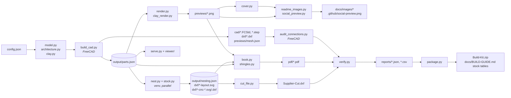

# How the build works

Every part, placement, PDF page, cut sheet and render is generated from `source/`. Nothing in `output/` is edited by hand. To change the house, change `source/config.json` (or the Python that reads it) and rebuild.

## Two Python runtimes

| Runtime | Used for | What it provides |
| --- | --- | --- |
| **FreeCAD 1.1+ bundled Python** | `build_cad.py`, `audit_connections.py`, `thickness_check.py`, `run_stress_tests.py` | FreeCAD, Part, Sketcher, Mesh (the OpenCASCADE solid kernel), numpy, shapely |
| **Your own Python 3.12+** (`.venv`) | `model.py`, `nest.py`, `stock.py`, `render.py`, `cover.py`, `decorate_cad.py`, `book.py`, `cut_file.py`, `verify.py`, `package.py`, `serve.py`, `config_check.py`, `export_viewer.py`, `release.py` | `requirements.txt`: reportlab, Pillow, numpy, pypdf, jsonschema, shapely (plus pytest from `requirements-dev.txt` for the tests) |

`make all` runs everything in order: `make check` (config check and tests), `make build` (`source/rebuild.py`) and `make tolerance` (`thickness_check.py`). `source/rebuild.py` drives both runtimes. It checks the config first (`config_check.py`) and empties `output/`, so no file from an earlier build survives. It then runs the FreeCAD stages headless (`MOOMIN_HEADLESS=1`, `QT_QPA_PLATFORM=offscreen`), then the rest in the Python that launched it. Any failed check stops the build: `build_cad.py` exits with a list of the failures before nesting starts, and `verify.py` and `package.py` refuse to continue.

`model.py` itself needs only numpy, so `source/serve.py` can generate the viewer data without FreeCAD.

## Data flow



## Stages

| Order | Script | Runtime | Reads | Writes |
| --- | --- | --- | --- | --- |
| 1 | `build_cad.py` | FreeCAD | `config.json` via `model.py`, `clay.py` | `output/parts.json`, native `MoominHouse.FCStd`, the closed, open and exploded STEP files, one STEP per part, one DXF per profile, `previews/mesh.json`, `reports/cad-validation.json` (overlaps, wall swing to the stop posts, door sweep, drawer, roof lift, window clearance, figures through doorways); exits with an error if any of them fails |
| 2 | `audit_connections.py` | FreeCAD | `parts.json` | `reports/furniture-connections.json` |
| 3 | `nest.py` (+ `stock.py`, `cnc.py`, `dxf_r12.py`) | venv (shapely, one process per part order) | `parts.json` | `nesting.json` (with each sheet's hand-drilling list), full-size sheet SVGs, CNC operation SVG/DXF sheets and one layered DXF per sheet |
| 4 | `stackup.py`, `risk_audit.py` | venv | `parts.json` | `reports/stackup.json` (joint tolerance chains), `reports/risk-audit.json` (tip-over, small parts, magnets); either exits with an error on a failure |
| 5 | `render.py` (+ `clay_render.py`) | venv | `parts.json`, `previews/mesh.json` | the CAD-derived illustrations and the clay figure renders in `output/previews/` |
| 6 | `cover.py` | venv | `previews/cover-house.png` | `previews/cover.png` |
| 7 | `readme_images.py` (+ `social_preview.py`) | venv | `output/previews/` | web-optimised illustrations in `docs/images/` and `.github/social-preview.png` for the README |
| 8 | `decorate_cad.py` | venv | `MoominHouse.FCStd`, `parts.json` | GUI colours and visibility saved into the `.FCStd`, `reports/native-materials.json` |
| 9 | `book.py` (+ `shingles.py`, `supplier.py`, `pdf_assembly.py`) | venv | `parts.json`, `nesting.json`, previews, CAD report, locale catalogs | eight PDFs, supplier CSV, PDF report, template indices, supplier index and clickable contents index |
| 10 | `cut_file.py` | venv | `parts.json`, `nesting.json` | `output/Moomin-House-Supplier-Cut.dxf` (every sheet's cutting lines in one DXF, one layer per thickness) and `reports/supplier-cut-file.json` |
| 11 | `verify.py` | venv | everything above | `reports/release-validation.json`, `parts.csv`, `hardware.csv`, `stock.csv` |
| 12 | `package.py` | venv | the validation report, `nesting.json` | `output/Moomin-House-Build-Kit.zip`, `reports/build-manifest.json`, and the stock tables in `docs/BUILD-GUIDE.md` |

`package.py` refuses to package if any release check failed. After the build, `thickness_check.py` (FreeCAD) rebuilds every plywood part at the thinnest and thickest end of `thickness_tolerance`, about its mid-plane, reruns the CAD checks and writes `reports/thickness-tolerance.json`. Overlaps between parts that already touch at nominal size count as shifts; an overlap where the design had a gap fails the check. `verify_gui.py` is an optional extra: run it with FreeCAD's Python to check that the saved GUI document restores.

A full rebuild takes about three minutes on an Apple-silicon Mac. The FreeCAD CAD stage takes about 50 s of that and nesting about 70 s (24 part orders per thickness on all cores).

## Source modules

| File | Role |
| --- | --- |
| `config.json` | The design parameters. See [below](#the-config-file). |
| `config.schema.json`, `config_check.py` | The JSON Schema for the config (types, units, limits and a description per key) and the checker that also applies the cross-field rules. |
| `model.py` | The single source of truth for parts and placements: every plywood profile (outline, openings, holes, jigsaw starter holes), every placed instance, hardware, fasteners, glue joints, dimensions and derived values. `python source/model.py` writes `output/parts.json` on its own. |
| `architecture.py` | Entrances (main, veranda, back door), the permanent veranda, stairs, the attic dormers, seam battens and rope ladder, cellar hatch, woodpile, ballast and anti-tip anchor, built with the same `add`/`put` API as `model.py`. |
| `steps.py` | Which pieces each assembly step installs; the book prints each step's parts and `verify.py` fails if a piece is in no step or two. |
| `stackup.py` | Joint-by-joint plywood tolerance chains at both ends of every thickness band (`make stackup`). |
| `risk_audit.py` | Tip-over with the walls open, small parts, magnet enclosure and pinch-gap rules (`make stackup`). |
| `dxf_r12.py` | Standards-clean DXF R12 writer used for every DXF the build writes. |
| `clay.py` | The thermo-clay figures as smooth unions of signed-distance "lumps", meshed with surface nets (display) and marching tetrahedra (volume). Pure numpy. |
| `build_cad.py` | Turns `parts.json` into native FreeCAD sketches, extrusions, cuts and linked assembly instances, then runs the solid-kernel checks and exports STEP and DXF. |
| `nest.py` | Packs every fabrication profile onto A3 stock, 3 and 6 mm, with per-part end margins and 3 mm laser lanes, and writes the cut sheets. Each part is placed by its true footprint on a 1 mm free-space grid (an FFT correlation), so small parts fill the hollows of rings and quarter circles. For each thickness it runs `make stock`'s packer in 24 part orders (the planner's two and 22 seeded variants), each followed by the planner's merge pass (empty the least used sheet into the others) and squeeze pass (re-pack the 2–4 least used sheets together), and keeps the plan with the fewest sheets. The seeds are fixed, so every build nests the same. |
| `render.py`, `clay_render.py` | Flat-shaded CAD illustrations and soft clay renders, rasterised in numpy. Each image gets a `.json` sidecar with its projection, so the book can draw dimensions over it. |
| `cover.py` | Paints the cover scene in code around the CAD render. |
| `book.py`, `shingles.py` | The A4 building book (ReportLab): instructions, dimensioned parts, 1:1 tiled cutting templates, decor and roof shingle strips. |
| `supplier.py`, `locales/`, `supplier_sources.json` | Single-language supplier appendix: Polish by default, English with `--lang en`. Separate reference pages and clean, native-size cutting paths; stock and machine-envelope checks reject parts that cannot fit whole. |
| `stock.py`, `stock_report.py`, `ops/stock.py`, `ops/suppliers/` | Plywood purchase planner (`make stock`): nests the house's plywood parts on a supplier's sheet sizes with its spacing, edge margin and saw kerf, prices single sheets, packs and boards the supplier cuts into formats, and writes the "Optymalne wymiary i cennik" PDF. Supplier profiles are JSON, one offer per line. |
| `cut_file.py` | The single supplier cut file: every A3 sheet side by side, through cuts only, one layer per thickness (`make cutfile`). |
| `pdf_assembly.py`, `pdf_checks.py` | Printed linked contents after the cover, A4 supplier summary, and geometry comparison against CNC operation DXFs. |
| `verify.py`, `audit_connections.py` | Independent release checks and the shopping and cutting CSVs. |
| `serve.py`, `viewer/` | The local three.js viewer (three.js r160 is vendored in `viewer/vendor/`, MIT licence). |
| `export_viewer.py` | Writes the viewer and its data as a static site, for GitHub Pages. |
| `release.py` | Uploads the PDFs, the supplier cut DXF and the build kit to a GitHub release, after checking the build is current and committed. |
| `rebuild.py`, `package.py`, `decorate_cad.py` | Orchestration, packaging and FreeCAD GUI colours. |

## Conventions

- Units are millimetres; angles in `config.json` are degrees.
- Z points up. Z = 0 is the underside of the round base B01. The plan origin is the tower axis.
- The twelve wall facets are W01–W12. `facet_angle('Wnn')` gives a facet's outward normal: −75° for W01, then +30° per facet.
- A **profile** (`parts[id]`) is a flat plywood outline in its own local frame, with the lower-left corner at 0,0. It has `outer`, `cuts` (openings), `holes`, `starters`, `thickness`, `quantity`, `color` and `note`.
- An **instance** (`instances[]`) places a profile in the house: `origin` plus the in-plane axes `u` and `v`. The thickness runs along `w = u × v`. `group` says which assembly it belongs to: `Fixed`, `WallLeft`, `WallRight`, `Roof`, `RoofLocks`, `Porch`, `Drawer`, `RoomDoors`, `Furniture`, `Garden` or `Tools`. The clay figures are listed separately, under `clay`. The viewer and the renders move whole groups to open the walls, lift the roof and explode the model.
- Identical profiles share one build ID, including furniture and strips with different orientations. The comparison includes thickness, outlines, openings and drilling details. Furniture and the garden scene use no cutting stock.
- The viewer, CAD labels and cutting templates show the shared build ID. For example, all 22 three-wall corner ribs use `J01`. Internal instance IDs such as `J01-01` identify individual placements for joints and moving hardware. The `design_part` field preserves the original assembly role for furniture renders and contact checks.
- `render_only` marks furniture and the garden scene. These profiles exist only in the viewer data and preview meshes. `fabrication_parts(data)` excludes them from the native CAD project, STEP and DXF files, parts lists, templates and supplier sheets.
- `derived` holds values computed from the config that the book, the viewer and the checks share: floor tops, hinge axes, views, dimensions, the drawer and the veranda.

To add a part, call `add(...)` to define its profile and `put(...)` (or `upright`, or `vertical_plate`) to place it. Rebuild and every downstream file picks it up: CAD, nesting, templates, book pages, the viewer and the checks.

## The config file

`source/config.json` drives everything below. `source/config.schema.json` describes each key with its units and limits, and editors use it for autocompletion through the `$schema` line at the top of the config. `source/config_check.py` validates a config against the schema and these cross-field rules:

- the main and veranda doors are on different facets;
- the veranda door is on the veranda's facet;
- the roof is wider than the tower;
- every hinge fits on its wall or door, and its holes are on the leaf;
- every plywood thickness the config names has stock: the thickness roles, the base, floor and plinth-floor support strips, and the laser thickness. The schema allows only 3 and 6 mm plywood;
- every sheet is larger than its margins.

`rebuild.py`, `serve.py` and `export_viewer.py` run the check before they build.

| Key | Controls |
| --- | --- |
| `height` | Total height. The roof takes up any change above the walls. |
| `base_diameter` | The round grey base. |
| `plinth` | Plinth height and apothem, panel thickness, and the hidden drawer (direction, size, travel). |
| `partition` | The room dividers and their doorways. |
| `figures` | Which clay Moomin stands on which floor (`levels`), their turn, their finished `heights`, the `door_clearance` every figure must have in every doorway, and the clay estimate (`density`, `block`, `allowance`, `foil_wall`). |
| `stairs` | The veranda side stair. |
| `tower_diameter`, `roof_diameter`, `floor_pitch`, `wall_height` | The main proportions. |
| `thickness` | Plywood thickness per role: `structure`, `base`, `wall`, `furniture`, `detail`, `floor`. Each is 3 or 6 mm, the only two sheet thicknesses: `structure` (6) covers the pillars and the lower turn-button ply, `detail` (3) the doors, railings, trim, seam strips and the upper turn-button ply, `furniture` (3) the drawer bottom. |
| `moving_clearance`, `nest_spacing`, `stock_margin`, `starter_diameter` | Workshop tolerances. `nest_spacing` defaults to 3 mm for laser cutting. Router cutting requires wider lanes and new nesting. |
| `fabrication` | A3 stock, pillar opening allowance, pillar end margins, floor and base support sections, base lift, and floor seam position. |
| `laser` | Legacy settings for thin laser sheets. The A3 fabrication policy uses `nest_spacing` for both thicknesses. |
| `supplier` | Revision, raw material, engraving choice, permitted stock sizes, machine envelope and proposed manufacturing tolerances. Null tolerances require supplier agreement. Furniture is excluded in the current project. |
| `wall_hinge`, `door_hinge` | Hinge footprints, hole patterns, centres, pilot holes and packing. Measure your real hinges. |
| `doors` | Which facets carry the main door and the veranda door. |
| `magnets` | Magnet and steel-disc sizes and the pockets they are bedded in. |
| `wall_catch` | The MC1 catch blocks under the attic floor: size, distance from the front seam, air gap. |
| `wall_stop` | The GP1 garden stop posts: opening `angle` (also the open angle of the renders, viewer and swing check), post section and height, contact point, gap. |
| `thickness_tolerance` | Measured plywood band per nominal thickness, `[minus, plus]` mm, for `make tolerance`. |
| `veranda` | Facet, deck size, column height, roof pitch, overhang and column positions. |
| `stock.main`, `stock.optional` | The plywood sheets available per thickness, `"3"` and `"6"` only. `stock.main` covers the house. `stock.optional` remains for compatibility and is unused. |
| `colors` | The palette used by CAD, the renders, the viewer and the book. |

Not every combination is valid: a much smaller tower will not fit the furniture, and a different veranda facet may collide with the opening walls. That is what the checks are for. Read `output/reports/release-validation.json` after a rebuild.

## Workflows

**Preview a change in seconds (no FreeCAD):**

```sh
# edit source/config.json, then:
.venv/bin/python source/serve.py --rebuild --open
```

**Full rebuild:**

```sh
make all                          # or: make check / make build / make tolerance / make clean
make all FREECAD_PYTHON=/path/to/freecad/python   # FreeCAD outside /Applications
```

Without `make`: `.venv/bin/python source/rebuild.py --freecad-python /Applications/FreeCAD.app/Contents/Resources/bin/python`.

**The supplier cut file (one DXF with everything to cut):**

```sh
make build      # the full rebuild writes it after the book (cut_file.py)
make cutfile    # rewrite it from the last build's nesting, about a second, no FreeCAD
```

Both write `output/Moomin-House-Supplier-Cut.dxf` and `output/reports/supplier-cut-file.json` (each sheet's slot origin, the layers and the blind or hand-drilled features left out). `make cutfile` reads `output/parts.json` and `output/nesting.json` and does not re-nest. After a change to the design or the config, run `make build`, so the DXF and the supplier PDF's sheet maps come from the same nesting. `verify.py` re-reads the file in every build and fails if any outline, opening or through hole is missing. Pushing a `v*` tag rebuilds everything in CI and attaches the DXF to the release; `release.py` attaches it too.

Add `--lang en` to `rebuild.py` for an English supplier appendix. With current CAD, nesting and previews already generated, `.venv/bin/python source/book.py --lang pl` rebuilds only the PDFs and PDF indices. Run `source/verify.py` and `source/package.py` afterwards to refresh validation and the kit. Each run produces one appendix language; production contours are identical across languages. Supplier and contents pages embed the bundled DejaVu Sans fonts for Polish characters; the workshop book keeps its existing fonts.

The clean production pages preserve the physical stock dimensions rather than A4 paper tiles. Every requested copy must occur exactly once and its full outline must stay inside one sheet's cutting window. The exporter also checks the stock format and machine envelope. The model explicitly divides the base, floors and ring into supported sections before nesting. Export never splits a fabrication section. Each large part uses two A4 template pages with overlap. The complete book includes an A4 supplier summary, while native A3 machining pages remain separate. PDF validation compares the clean paths with the operation DXFs within 0.0002 mm for PDF numeric encoding; this is not an agreed manufacturing tolerance. The `thickness_tolerance` CAD stress test is also separate from the tolerances to agree with the supplier.

**See what a change did.** `output/` is not in git, so before you edit, copy `output/parts.json` and `output/nesting.json` to a scratch folder. After the rebuild, diff the new files against those copies. The validation report lists every check with its detail.

**Font.** The cover title is lettered in Chalkboard SE, which ships with macOS. Elsewhere it falls back to DejaVu Sans, then to Pillow's built-in font. Workshop PDF pages use built-in Helvetica. Supplier and contents pages embed the bundled DejaVu Sans fonts, including Polish characters; their licence is in `source/fonts/LICENSE_DEJAVU`.

## Tests

`tests/` holds fast checks that need no FreeCAD. They take about 10 seconds, one model build shared by all of them:

```sh
.venv/bin/python -m pip install -r requirements-dev.txt
make check
```

`make check` sets `PYTEST_DISABLE_PLUGIN_AUTOLOAD=1`, so pytest plugins from other environments on the path cannot break the run.

- **`test_config.py`:** the schema is valid, the shipped config passes, and a set of deliberately broken configs is rejected with the right message.
- **`test_model.py`:**
  - the height and floor levels match the config;
  - every part stands on the base, inside its circle;
  - instance counts match part quantities, and placement frames are orthonormal;
  - every outline and opening is a simple polygon, with its holes on the part;
  - every sheet part has plywood stock in its thickness;
  - the veranda stands on a fixed facet;
  - one clay figure stands per configured storey, and the clay estimate is consistent;
  - every figure passes upright through every doorway;
  - two catch and two stop magnets pair with four steel discs, and the open angle is the stop angle.

The solid-kernel checks (overlaps, wall swing, door sweep, drawer, roof lift, PDF scale) and the plywood thickness check still need FreeCAD (`make build`, `make tolerance`).

## 3D prints

The 3D-printable furniture is a separate, small pipeline. `source/print_build.py` builds each design in `source/prints/` with build123d on the Mac into STL, 3MF and STEP files and checks the STL (`source/print_mesh.py`, numpy). `make prints` publishes the designs that pass into the committed `prints/` folder. `export_viewer.py` copies it into the site next to `prints.html`. `make studio` (`source/print_studio.py`) is the live preview while a design is changed. CI re-checks the published STL files and fails when `prints/` is older than its sources. See [PRINTING.md](PRINTING.md).

## Continuous integration and publishing

`.github/workflows/ci.yml` runs the config check, Python tests and static viewer browser checks (the house viewer and the prints page) on pushes to `main` and pull requests.
The browser checks load the export under `/moominshouse/`, block external requests and check WebGL pixels and controls at desktop and mobile sizes.
On `main`, the workflow then uploads the export and deploys it to GitHub Pages.
See [PUBLISHING.md](PUBLISHING.md) for local checks and repository setup.
Before the first deployment, select **Settings → Pages → Build and deployment → Source: GitHub Actions**.
You can also enable Pages with the GitHub CLI:

```sh
gh api -X POST 'repos/<owner>/<repo>/pages' -f build_type=workflow
```

The full FreeCAD build does not run in the push and pull-request CI. Pushing a `v*` tag from `main` runs `.github/workflows/release.yml`, which does the full rebuild and tolerance check on Linux and publishes the release. Releases can also be made from a local build:

```sh
.venv/bin/python source/rebuild.py --freecad-python "$FREECAD_PYTHON"
git commit ... && git push                                   # release.py insists the source is committed and pushed
.venv/bin/python source/release.py v5 --dry-run              # check and preview the release notes
.venv/bin/python source/release.py v5                        # tag the current commit and upload the assets
```

`release.py` refuses to upload in any of these cases:

- a release check failed;
- `output/` was built from source that has changed since (it compares `output/reports/build-manifest.json` with the files on disk);
- the build kit contains the `original/` reference photos;
- the source isn't committed, or the commit isn't pushed.

It attaches the PDFs, `Moomin-House-Supplier-Cut.dxf` and `Moomin-House-Build-Kit.zip`. The tag workflow (`.github/workflows/release.yml`) attaches the same files plus the supplier CSV. The release notes give page counts, sizes and the plywood stock tables.
