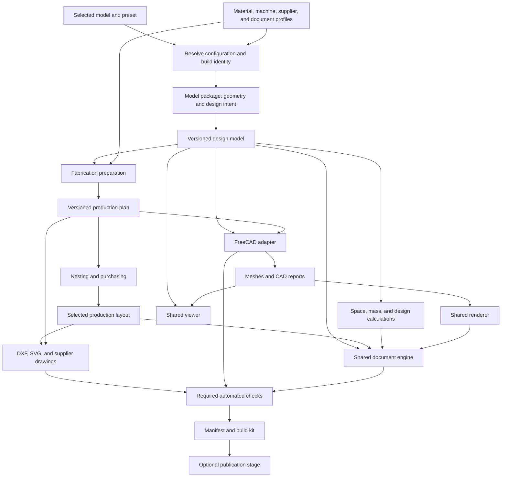
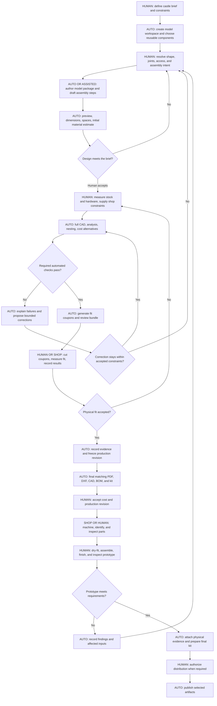

# Reusable CAD framework: refactoring plan and human workflow

This document proposes a reusable framework for the Moomin house, a new castle, and later models.
It describes future work. It does not implement the framework or define the castle design.

The target is one shared pipeline that accepts a selected model and generates its CAD, drawings, calculations, instructions, and build kit.
A new model supplies geometry and design intent. It does not copy the PDF, DXF, nesting, or reporting code.

The review uses the working tree as it exists on October 15, 2026, including current uncommitted work.
The source and workflow files were inspected. No CAD build or physical validation was performed for this plan.

## 1. Scope and design decisions

- Keep the Moomin house as the first model package. Add the castle as a separate package.
- Start with plywood assemblies, purchased components, and optional display geometry, which match the existing pipeline.
- Keep FreeCAD as the first CAD backend. Isolate its runtime so other stages need no FreeCAD installation.
- Use one Python repository and explicit interfaces. A separate service or public plugin marketplace is unnecessary initially.
- Exchange versioned data between stages. Downstream stages must not import a particular model generator.
- Keep design geometry separate from fabrication geometry. A manufacturing process can add cutter relief without changing the design definition.
- Select the model explicitly for every operation. Store outputs separately for each model, configuration, and build.
- Separate creative design choices from material, machine, supplier, and document configuration.
- Generate repeatable artifacts automatically. Record human decisions and measurements as reusable inputs.

The initial contract supports planar profiles with thickness, placed assemblies, purchased solids, and preview meshes.
An arbitrary curved solid can appear in CAD or a preview without automatically acquiring a plywood cutting plan.
Future fabrication methods require explicit adapters and capability declarations.

## 2. What is coupled today

| Area | Evidence in the current source | Consequence for another model |
| --- | --- | --- |
| Model construction | `source/model.py` loads `CFG` at import and mutates shared part, instance, hardware, and joint collections. | Two models or configurations cannot be treated as independent inputs without careful state management. |
| Geometry and helpers | `model.py` combines polygon helpers, profile registration, placements, house geometry, furniture, figures, and derived dimensions. | General helpers and Moomin design rules share one module. |
| Fabrication | `source/fabrication.py` imports `model`, mutates its collections, and addresses `B01`, `F00`, `F01`, `F02`, and `R02`. | Panel splitting and seam support depend on the house layout. |
| Configuration | `config_check.py` requires A3 blanks, three equal stories, specific facets, and house-specific relationships. | A valid castle can fail unrelated house rules. |
| CAD and checks | `build_cad.py` creates solids, exports files, derives contacts, and checks specific wall, door, drawer, and roof motions. | Exporting another model requires changes to the same script. |
| Motion | `build_cad.py`, `render.py`, `thickness_check.py`, and `viewer/app.js` repeat assumptions about movement groups. | A drawbridge or sliding gate needs edits in several consumers. |
| Nesting and purchasing | `nest.py` and `stock.py` share packing logic and depend on model constants. Some placement choices use roof part IDs. | The packing engine is reusable, but selection and policies need separation. |
| Sheet selection | `stock.py` explores supplier formats. Configuration and production checks restrict the current design to A3. | A cheaper purchase layout does not automatically become an accepted production layout. |
| PDF generation | `book.py` combines drawing utilities with house instructions, named part IDs, decor, figures, and filenames. | Generic page generation cannot be selected independently from house content. |
| Supplier exports | `supplier.py`, `pdf_checks.py`, and `cut_file.py` contain project names, PDF metadata keys, or fixed output paths. | A castle can inherit Moomin branding and asset expectations. |
| Validation | `verify.py` mixes reusable checks with exact house quantities, six doors, wall facets, floor thicknesses, and figure rules. | A different design cannot use the release gate unchanged. |
| Engineering analysis | `stackup.py`, `risk_audit.py`, and `run_stress_tests.py` contain house-specific joints, loads, support positions, or materials. | Reusing an equation requires separating it from its particular engineering case. |
| Orchestration | `rebuild.py` empties the shared `output/` folder and runs a fixed script sequence. | Switching models replaces previous outputs and assumes every feature exists. |
| Packaging | `package.py` uses fixed kit names, packages broad repository folders, and updates `docs/BUILD-GUIDE.md`. | Building one model can change shared documentation or include another model's content. |
| Publication | `release.py`, the Makefile, and GitHub workflows assume one model and fixed assets. | Releases and viewer deployment cannot select models independently. |
| Tests | `tests/conftest.py` builds the global house model. Other tests mix generic algorithms and house invariants. | Passing tests for one design does not establish framework independence. |

Useful foundations already exist: flat profiles, placed instances, shared build IDs, display exclusions, DXF writing, PDF scale checks, and stock optimization.
These foundations need clear ownership and interfaces. A complete rewrite of their algorithms is unnecessary.

## 3. Proposed framework boundaries



The model package depends on the common contract and geometry helpers.
Shared services depend on those contracts, never on `models.moomin_house` or `models.castle`.
The runner selects and loads a model package through one explicit registry.

FreeCAD consumes serialized inputs in its own process. It returns artifacts and reports through documented paths.
Model checks that require FreeCAD receive a backend context through a registered hook.
They do not require the PDF, stock, or viewer services to import FreeCAD.

### Proposed repository layout

This tree illustrates ownership. These directories do not exist yet.

```text
framework/
  contracts/             Design model, production plan, reports, schemas
  geometry/              Profiles, transforms, joints, deduplication
  analysis/              Space, mass, tolerance, stability, load-case helpers
  fabrication/           Process preparation, panel sections, machining features
  nesting/               Shared packing engine and purchasing optimizer
  documents/             PDF layout, templates, supplier pages, localization
  rendering/             Cameras, images, annotation projection
  backends/freecad/      Native CAD, STEP, meshes, solid checks
  exporters/             DXF, SVG, CSV, manifests, archives
  pipeline/              Configuration resolution, stages, dependencies, CLI
models/
  moomin_house/          Existing design, presets, checks, instructions, assets
  castle/                New design using the same contracts
profiles/
  materials/             Nominal sizes, measured bands, density, grade
  machines/              Bed size, tools, process limits, operation support
  suppliers/             Offers, packs, prices, agreed production constraints
  documents/             Paper, language, fonts, document bundles
viewer/                  Shared application and vendored libraries
tests/
  framework/             Algorithms and contract checks
  models/                Design-specific checks
  integration/           End-to-end builds and model isolation
docs/                    Framework documentation and migration plan
output/<model>/<build>/  Immutable generated artifacts and reports
```

Keep shared components small. Extract a reusable castle component only after its interface is clear from actual use.
Start with profiles, placements, joints, hinges, and panels. A universal castle description language is outside the first migration.

## 4. The data contract that makes models interchangeable

The contract is the main refactoring deliverable. Moving files alone does not remove coupling.
Use validated Python structures internally and versioned JSON for stage boundaries.

| Contract element | Required information | Owner |
| --- | --- | --- |
| Project identity | Model ID, title, design revision, attribution, selected preset, supported capabilities | Model package |
| Build context | Resolved configuration, input hashes, tool versions, output root, deterministic seeds | Pipeline |
| Units and frames | Millimeters, angle units, coordinate convention, local frames, world transforms | Shared contract |
| Design parts | Stable design IDs, geometry references, material references, semantic roles | Model package |
| Manufactured profiles | Outer contours, openings, thickness, holes, faces, depths, quantities, finish and grain constraints | Fabrication stage |
| Instances | Unique instance IDs, part references, transforms, assembly membership, inclusion policy | Model package |
| Purchased components | Catalog IDs, specifications, quantities, placements, optional CAD representation | Model package and shared catalog |
| Joints | Connected instances, mating frames, contact intent, fit, clearance, fasteners, tolerance terms | Model package using shared joint definitions |
| Motions | Parent assembly, axis, pivot, limits, named poses, prerequisites, permitted contacts | Model package |
| Spaces | Room or level boundaries, openings, floor elevation, ceilings, obstructions, clearance requirements | Model package |
| Assembly process | Step IDs, dependencies, installed instances, hardware, tools, cure times, checks, text references | Model package |
| Presentation | Cameras, exploded offsets, dimensions, labels, palette, cover assets, optional sections | Model package and document profile |
| Production plan | Material groups, process assignment, stock, layout, operations, manual operations, source revision | Shared pipeline |
| Analysis reports | Values, units, assumptions, method, evidence, status, relevant part or case IDs | Analysis services |
| Artifact manifest | File roles, paths, hashes, build ID, required checks, physical validation status | Shared pipeline |

Contract rules:

1. Treat IDs as opaque references. Keep meaning in fields such as `role`, `material_id`, and `assembly_id`.
2. Derive quantities from instances or explicit consumable requirements. Prevent duplicate counts between hardware and purchased-part lists.
3. Distinguish fabricated, purchased, consumable, tool, and display items explicitly. Separate optional inclusion from display-only status.
4. Preserve design IDs when identical manufactured profiles share a cutting ID. Keep the mapping in every relevant report.
5. Include material, machining face, finish, grain, and allowed rotations in deduplication compatibility.
6. Reject dangling references, invalid transforms, non-finite coordinates, invalid contours, and unsupported schema versions before exports.
7. Keep CAD-derived contacts and measurements in result data. Downstream stages must not depend on hidden mutations of the input model.
8. Use common calculation results across PDFs, CSVs, and viewer labels. Renderers must not recompute engineering values independently.
9. Declare optional capabilities. An absent drawer or clay figure is valid when the model does not declare that capability.
10. Record unsupported capabilities as errors or explicit exclusions. Missing evidence must not produce a passing check.

A static castle can omit motions. A castle with a drawbridge declares a revolute joint with its own axis and limits.
The viewer, CAD poses, illustrations, and clearance checks consume the same motion definition.
More complex mechanisms can later add dependency constraints without special castle branches in each exporter.

## 5. Refactoring checklist

The order below favors small, reviewable changes. Each item includes a concrete completion condition.

| # | Elements to refactor | Planned change | Completion condition |
| --- | --- | --- | --- |
| 1 | Existing outputs and tests | Capture a reproducible Moomin baseline before moving behavior. Record configuration, counts, dimensions, layouts, and reports. | Later builds can explain every intended difference from the baseline. |
| 2 | Data dictionaries and `parts.json` | Define the versioned contracts above and adapt current data into them. | A serialized model passes schema and reference checks without importing its generator. |
| 3 | `model.py`, `architecture.py` | Move the house generator into a model package. Replace import-time configuration and globals with an explicit build context. | Two configurations build in either order without leaking state. |
| 4 | Helpers in `model.py` | Extract profile builders, placement transforms, geometry normalization, and compatible deduplication. | Shared helpers accept explicit inputs and contain no house IDs or dimensions. |
| 5 | `config.json`, schema, checker | Split model parameters from material, machine, supplier, document, and runtime configuration. Keep cross-field house rules in its package. | The castle requires no veranda, wall-facet, figure, or A3-only fields. |
| 6 | `fabrication.py` | Separate reusable splitting and joint operations from house-specific seam and support choices. | Models declare split policies and supports through data or explicit hooks. |
| 7 | `build_cad.py`, `decorate_cad.py` | Extract a FreeCAD adapter for native documents, solids, STEP, meshes, and appearance. Separate checks from export. | The same adapter builds a small non-house fixture without code changes. |
| 8 | Motion code across CAD, renderer, viewer, tolerance checks | Introduce one assembly hierarchy and motion specification. Share pose semantics across Python and JavaScript. | A declared drawbridge rotates consistently in exports, renders, the viewer, and sampled collision checks. |
| 9 | `verify.py`, `audit_connections.py` | Split framework invariants from model-specific rules and contact expectations. | Universal checks run for both models. House quantity assertions run only for the house. |
| 10 | `stackup.py`, `thickness_check.py` | Extract tolerance arithmetic and scenario execution. Supply datum relationships and fit requirements from joints. | Reports distinguish a dimensional chain from a full geometric rebuild and state each method's limits. |
| 11 | `risk_audit.py`, `run_stress_tests.py` | Extract equations and solver integration. Put material assumptions, supports, loads, and acceptance limits in explicit cases. | Each result names its design case, inputs, and evidence. No castle result inherits a house load case silently. |
| 12 | `nest.py`, `stock.py` | Isolate the shared packer from model selection, sheet policy, and pricing. Remove roof-ID shortcuts. | Generic shapes and both models use the same engine with declared rotation and grain constraints. |
| 13 | `ops/stock.py`, `stock_report.py`, supplier profiles | Separate interactive data collection from headless optimization. Select a production plan from accepted supplier offers. | One supplied profile can generate a report without prompts and drive matching production layouts. |
| 14 | Space and material calculations | Create shared metric services with explicit definitions and units. | Known synthetic examples establish correct results independently of house dimensions. |
| 15 | `dxf_r12.py`, `cnc.py`, `cut_file.py` | Keep the DXF writer shared. Separate machining features, operation policy, placement transforms, and combined-file layout. | PDF, SVG, and DXF outputs reference the same production plan and preserve face and depth information. |
| 16 | `book.py`, `pdf_assembly.py`, `hand_templates.py` | Extract pagination, fonts, tables, dimensions, tiled templates, calibration, contents, and document composition. | A model supplies content and geometry without duplicating drawing utilities. |
| 17 | `steps.py` and instructions in `book.py` | Replace selector rules based on part IDs with explicit step assignments and dependencies. Keep authored procedures in model content. | Each required instance belongs to one installation step. Hardware and non-installation steps remain traceable. |
| 18 | `supplier.py`, `pdf_checks.py`, `locales/` | Parameterize identity, document roles, metadata keys, paper formats, translations, and image sources. | Supplier output is correctly branded for either model, with clean production pages and independent geometry checks. |
| 19 | `render.py`, `cover.py`, `readme_images.py`, `social_preview.py` | Extract rendering and annotation services. Move house cameras, scenery, palette, and titles into presentation data. | Castle previews require assets and camera definitions, without editing the renderer. |
| 20 | `clay.py`, `clay_render.py`, `shingles.py` | Keep reusable meshing and material estimation separate from characters and roof-specific decor. Make these features optional. | A model without figures or shingles produces a complete kit without placeholder sections. |
| 21 | `viewer/`, `serve.py`, `export_viewer.py` | Build controls and labels from capabilities and motion data. Parameterize data paths, titles, and export ownership markers. | A static model and a moving castle both load without house-specific nodes. |
| 22 | `rebuild.py`, Makefile, output paths | Introduce a selected-model runner with stage inputs, outputs, runtime requirements, and isolated build directories. | One model's build or cleanup cannot replace another model's artifacts. |
| 23 | `package.py`, `release.py`, workflows | Use the artifact manifest for expected outputs, archive content, filenames, and selected-model release assets. | The kit matches the checked build and contains only selected-model content and declared shared dependencies. |
| 24 | Tests, documentation, dependency configuration | Separate framework tests from model tests. Document model creation and both runtime environments. | Both models pass shared integration checks through one documented entry point. |

### Configuration resolution

Use this precedence: framework defaults, selected model preset, selected shared profiles, then explicit run overrides.
Reject unknown keys and incompatible overrides. Save the complete resolved configuration in the build manifest.

Changing a purchase-planner thickness mapping must not silently change the manufactured design.
A real material substitution requires new fit, strength, tolerance, and geometry results before production export.

The current 3 mm and 6 mm restrictions belong to the Moomin preset and its manufacturing rules.
The framework supports any thickness that its selected model and process can validate.

### Geometry and fabrication preparation

Keep ideal panel geometry available for design calculations and presentation.
Derive manufactured sections, fit allowances, cutter relief, starter holes, and manual operations through a declared fabrication policy.

Panel splitting needs model intent: permitted seams, structural supports, grain, and access during assembly.
The framework can propose a split, but it cannot infer a sound structural seam from sheet size alone.
Move the existing house seam decisions into its package before extracting general operations.

Every split must preserve hole ownership, fastener references, assembly steps, and traceability to the original design part.
Unsupported operations appear in a manual-work list or fail the selected production profile.

### Production plan and material accounting

Use one accepted production plan for nesting maps, supplier PDFs, DXFs, purchase quantities, and material reports.
Keep alternative cost estimates separate until a plan is selected.
A supplier that rearranges parts creates a new production revision and requires refreshed layout evidence.

The current packer uses heuristic searches. Label the result as the best evaluated plan and record the search settings.
Do not claim a mathematical optimum unless a future solver establishes one.

The existing exports describe cutting geometry and machining operations. They are not a general machine-ready toolpath system.
Automatic G-code requires a separate CAM adapter, machine configuration, tool setup, and process validation.

## 6. Reusable calculations, including space and plywood

Space has several meanings. Publish separate values rather than one ambiguous area or volume.
The current source already calculates some utilization, mass, and geometry measurements.
General room-space analysis is additional work.

| Metric | Definition and required inputs | Automation and limits |
| --- | --- | --- |
| Overall dimensions | Bounding dimensions of selected instances in a named pose | Automatic from geometry. Exclude display objects and tools according to the report scope. |
| Table or storage footprint | Horizontal projection of the selected assembly | Report closed and operating poses separately. Do not substitute the bounding rectangle for the true projected area. |
| Gross floor area | Sum of declared floor regions by level | Model supplies floor boundaries and identifies courtyards, stair voids, and overlaps. |
| Usable floor area | Floor region minus walls, columns, voids, and declared obstructions | Model supplies the occupancy policy. Report structural and furnished variants separately. |
| Usable interior volume | Declared interior regions minus relevant solids, with actual ceiling boundaries | Use closed regions or valid solids. A bounding box is only an envelope estimate. |
| Access and movement clearance | Door openings, required object envelopes, and swept or sampled moving geometry | Input includes clearance targets. State sampling intervals and unsupported continuous-motion guarantees. |
| Gross profile area | Sum of outer contour areas multiplied by required copies | Useful for consistent comparison with existing utilization reports. |
| Finished material area | Outer area minus through openings and through holes, multiplied by copies | Keep blind pockets separate. Compare exact features and polygon approximations within declared tolerances. |
| Finished material volume | Finished planar area times thickness, less blind machining volumes | Use exact CAD volume when available and record the method. Avoid subtracting through holes twice. |
| Purchased plywood area | Sum of bought sheet areas, including sheets purchased in whole packs | Distinguish consumed stock, leftover sheets, existing stock, and purchased stock. |
| Utilization and waste | Finished material area divided by the stated consumed or purchased area | Report the denominator. Separate reusable offcuts from process loss when offcut tracking exists. |
| Material cost | Price of purchased sheets, packs, or board-cutting offers | Record grade, currency, price date, taxes, shipping, and excluded costs. Do not infer absent charges. |
| Mass and center of gravity | Component volumes and densities, purchased masses, placements, named pose | Mark estimates and missing data. Use explicit support contacts for stability calculations. |
| Tolerance and strength | Joint chains, thickness scenarios, material properties, loads, supports | Equations and solver setup are shared. Design cases and acceptance limits remain explicit inputs. |
| Consumables and labor estimate | Glue or finish coverage, operation quantities, setup and task assumptions | Report estimates separately from measured usage and actual workshop time. |

Add reusable offcut inventory after both models share a reliable production plan.
The first migration does not need to solve inventory allocation across several projects.

## 7. Future human labor workflow

One person can hold several roles. The graph distinguishes decisions and physical evidence from repeatable generation.
Most routine parameter changes return directly to the automated build after configuration changes.



For a digital-only project, fabrication and prototype steps do not apply.
The manifest still distinguishes digital checks from physical evidence.
Repeat builds can reuse physical evidence only when its input and process dependencies remain valid.

### Human inputs and outputs

| Human work | Necessary decision or evidence | Framework support | Frequency |
| --- | --- | --- | --- |
| Define the design | Castle style, overall dimensions, room layout, moving features, intended use, budget, manufacturing method | Structured brief and comparison with configured limits | Once per new model, then when requirements change |
| Resolve design intent | Joint choice, supported seams, assembly access, acceptable appearance and compromises | Reusable components, previews, failure reports, suggested alternatives | New geometry or mechanisms |
| Author missing geometry | Parameters for existing components, or new generator logic for novel forms | Workspace template, component library, assisted drafts, contract checks | Once per new component or model |
| Define engineering cases | Loads, supports, material properties, clearance targets, acceptable fits | Case templates and reusable analysis services | New structure, mechanism, or material |
| Provide real measurements | Plywood thickness and variation, hinge pattern, hardware sizes, printer scale | Measurement form, importable results, automatic range checks | New stock batch, hardware, machine, or printer setup |
| Confirm shop capability | Process per material, cutter, minimum feature, hold-down, grain, stock edges, operation faces, tolerances | Reusable supplier and machine profiles, unresolved-field report | New supplier or changed process |
| Accept cost and scope | Selected stock plan, optional parts, manufacturing revision | Cost comparison and a concise change report | Before spending money on a changed job |
| Validate fit physically | Coupon dimensions, joint fit, actual machining result | Generated coupons, measurement record, targeted rebuild | Before first production or relevant process changes |
| Fabricate and inspect | Cut quality, missing pieces, identification, material defects | Sheet maps, IDs, BOM, receiving checklist | Each physical batch |
| Validate assembly instructions | Reachability, assembly order, practical handling, cure and finish requirements | Generated step images, dependencies, quantity checks, prototype observations | First prototype and major assembly changes |
| Assemble and finish | Glue, clamps, fasteners, sanding, finishing, final movement and stability observations | Ordered manual, part labels, hardware allocations, inspection record | Each physical build |
| Accept distribution | Approved revision and any required public release decision | Complete manifest and prepared release assets | Each distributed revision |

Automation cannot infer a unique castle design from a style request.
Someone must resolve design ambiguity, either directly or by reviewing an assisted draft.
A new geometric family can require new model code, even when all exports remain reusable.

Physical measurements, fit, workmanship, and practical assembly need observations from a person or suitable measurement equipment.
CAD checks alone do not establish these facts.

## 8. Automation priorities

### First implementation

1. Provide one selected-model command for configuration checks, preview, production builds, stock reports, and kit generation.
2. Generate every artifact from the same resolved inputs and accepted production plan.
3. Run both runtime environments through one runner with dependency checks and readable failures.
4. Generate BOMs, hardware allocations, material reports, templates, dimensions, supplier documents, and assembly illustrations automatically.
5. Run shared checks and model checks automatically. Keep failed reports available for diagnosis.
6. Produce a review bundle with model images, changes, costs, unresolved inputs, and check results.
7. Store measurements and supplier decisions in profiles so the next run requires no repeated questionnaire.
8. Generate documentation into build outputs. Make updates to repository illustrations or authored documents an explicit separate action.

### After the two-model migration

1. Cache stages by all relevant input hashes, including model code, profiles, framework version, locale, tools, and assets.
2. Rebuild only affected stages. Preserve the full dependency chain in each result.
3. Add bounded parameter search for declared clearances, cost limits, and design dimensions.
4. Generate a small number of ranked alternatives with reproducible settings and a clear stopping condition.
5. Record prototype observations and invalidate affected physical evidence after material, geometry, hardware, or process changes.
6. Add offcut reuse and optional CAM integration only after production-plan consistency is established.

Automatic corrections can change only parameters with accepted bounds and explicit objectives.
A correction that changes appearance, joints, loads, materials, or production commitments returns to human design review.
Assisted text can draft instructions. Installation coverage and dependency checks cannot establish that the physical procedure is practical.

### Build and publication behavior

Use a fresh build directory and promote it only after its required checks finish.
Keep the previous successful build available when a new build fails.
Apply cleanup only within the selected generated build namespace.

Define preview, digital-production, and physically-validated states explicitly.
Attach required check sets to each build profile. Record skipped checks and reasons.
Optional work must not cause a required check to disappear.

Place the final manifest and archive after the checks they claim to include.
The current rebuild packages before the separate thickness stage, and `make all` packages again afterward.
The release workflow runs thickness checks after the rebuild without the same explicit final packaging step.
The refactor must give local and CI builds one finalization order.

Publishing remains a separate operation from artifact generation.
An authorized publishing workflow can run automatically after its configured conditions are met.
Routine local generation needs no new human approval.

## 9. Migration phases and acceptance criteria

### Phase 0: Record the baseline

- Record the current working tree state and resolved configuration.
- Capture semantic outputs: part and hardware counts, geometry, dimensions, stock use, template scale, and required reports.
- Record existing failures separately from regressions introduced during migration.
- Use a successful build as the baseline when the current design passes its required checks.

**Exit:** The existing house has a reproducible baseline or a clear record of unresolved baseline failures.

### Phase 1: Establish contracts and isolate the house

- Add the model registry, contracts, explicit build context, and output namespaces.
- Adapt the existing house into the contract before changing its geometric behavior.
- Replace global configuration and state with instance-owned construction data.
- Extract only the helpers needed for the first common boundary.

**Exit:** The house builds through the selected-model runner. Consumers read validated artifacts without importing its generator.

### Phase 2: Extract one complete vertical path

- Connect model selection to FreeCAD, a production plan, nesting, one PDF bundle, DXF, shared checks, and packaging.
- Keep temporary compatibility wrappers for old commands while this path stabilizes.
- Add a small generic fixture with no roof, figures, drawer, veranda, or moving walls.

**Exit:** The fixture generates correct artifacts through the same services. The house remains consistent with the baseline.

### Phase 3: Complete reusable consumers

- Separate model checks, engineering cases, assembly content, decor, and presentation assets.
- Move the viewer and renders to common motion and camera data.
- Connect purchasing alternatives to a selected production layout.
- Add space metrics and shared material accounting.
- Align final manifests, thickness results, archives, local commands, and CI.

**Exit:** Shared consumers contain no house-specific imports, required IDs, group names, filenames, or fixed page assumptions.

### Phase 4: Prove reuse with the castle

- Define the castle brief without changing framework contracts to imitate the house.
- Begin with a small manufacturable structure, such as a rectangular keep and a removable roof.
- Add one representative mechanism only if the brief requires it, such as a drawbridge.
- Supply castle-specific checks, assembly steps, space boundaries, and presentation data.
- Add reusable behavior to the framework only when it expresses a general capability.

**Exit:** Both models generate their full applicable bundles without model-specific branches in shared services.
The castle remains a separate design effort. The framework migration does not determine its architecture or dimensions.

### Phase 5: Reduce recurring labor

- Add dependency-based caching, configuration comparison, bounded optimization, and evidence reuse.
- Measure actual operator time for a parameter change, a material change, and a new model.
- Prioritize the remaining repeated manual tasks using those measurements.

**Exit:** Routine changes require input edits and one build operation, followed only by reviews or measurements that the change invalidates.

## 10. Final acceptance checklist

- [ ] A model switch requires selecting a package and configuration, without editing shared services.
- [ ] Both models can build sequentially in either order and concurrently without state or output contamination.
- [ ] A model without optional mechanisms or decor loads in the viewer and generates its applicable documents.
- [ ] Invalid geometry, missing references, unsupported machining, and missing required evidence stop the relevant build profile.
- [ ] Shared algorithms have small independent examples with known area, volume, fit, pricing, and quantity results.
- [ ] House-specific tests retain its design invariants without constraining the castle.
- [ ] Every manufactured copy appears exactly once in its production layout and required template coverage.
- [ ] Purchased components, tools, optional items, and display geometry receive consistent treatment across all outputs.
- [ ] PDF paths and DXF paths agree with the accepted production plan and declared units.
- [ ] Motion poses agree across CAD, renderer, viewer, and analysis within declared tolerances.
- [ ] Material reports state gross area, finished area, consumed stock, purchased stock, and their utilization denominators.
- [ ] Space reports distinguish dimensions, projected footprint, usable floor area, and interior volume.
- [ ] Thickness and engineering results identify their methods, assumptions, and required physical evidence.
- [ ] Failed builds preserve the last successful outputs and cannot produce a falsely complete kit.
- [ ] Final archives include the required final reports and match the manifest for that build.
- [ ] Build commands do not modify authored repository documents or unrelated model artifacts.
- [ ] A documented model template lists every required input and each optional capability.

The first milestone is the existing house plus a generic fixture through one complete export path.
The decisive proof of reuse is the house and castle producing matching artifact types through unchanged shared services.
